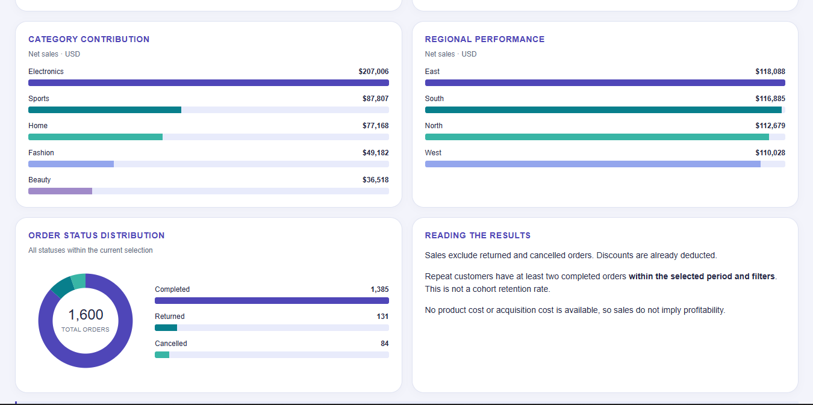

# E-commerce Sales and Customer Analytics


**Tools:** Python · pandas · Matplotlib · SQL · Power BI DAX · HTML/CSS/JavaScript

## 📊 Dashboard Previews

### E-Commerce Analysis Overview


### E-Commerce Core Metrics



*Static preview generated from the supplied CSV using Python. The [interactive HTML dashboard](dashboard/index.html) provides quarter, category and region filters. Download the repository and open that file in your browser; GitHub's file viewer displays its source.*

## Business problem

An e-commerce team needs to distinguish completed-order sales from total order activity, understand which categories drive revenue, and identify opportunities to investigate repeat purchasing and unsuccessful orders.

This project answers four questions:

1. How do completed-order sales and volume vary by month?
2. Which categories and regions contribute the most sales?
3. What proportion of active customers placed more than one completed order?
4. How much order activity is returned or cancelled?

## Dataset

- **Input:** `data/orders.csv`
- **Coverage:** January-December 2025; 1,600 orders; five categories.
- **Grain:** One order per row, with one category assigned to each order.
- **Fields:** Order ID, date, customer ID, category, quantity, unit price, discount, status and region.
- **Provenance:** Synthetic data supplied with this case study. The checked-in CSV is the reproducible input; the original generation script is not included.

Only `Completed` orders contribute to sales. Returned and cancelled orders remain in the status analysis.

## Workflow and skills demonstrated

| Stage | Work performed |
|---|---|
| Data validation | Check unique order IDs, missing values, positive quantities, nonnegative prices, discount bounds and allowed statuses |
| Python analysis | Calculate discounted sales, AOV, category mix and repeat-customer rate |
| SQL analysis | Analyze monthly sales, categories, repeat purchases, customer summaries, statuses and regions |
| Reconciliation | Compare the completed-order sales total calculated in SQL with pandas |
| Dashboard | Present KPIs, time trends, category/region comparisons and order statuses |
| Power BI preparation | Supply DAX measures, a matching theme and a report build specification |

SQL examples demonstrate conditional filtering, aggregation, CTEs, window functions and safe division with `NULLIF`.

## Key findings

| Metric | Result |
|---|---:|
| All orders | 1,600 |
| Completed orders | 1,385 |
| Net sales from completed orders | $457,680.39 |
| Average completed-order value | $330.46 |
| Active customers with completed orders | 299 |
| Customers with at least two completed orders | 278 |
| Repeat-customer rate | 93.0% |

- **Electronics contributed 45.2% of sales:** approximately $207,005.83. Confirm margins and product-level performance before increasing promotional spend.
- **215 orders were not completed:** 131 returned and 84 cancelled, together representing 13.4% of all orders. Investigate the underlying reasons before assigning a financial impact.
- **21 active customers purchased only once.** This creates a small segment for a follow-up purchase experiment; it is not evidence that those customers have churned.
- **Repeat purchasing is high in this synthetic dataset.** Treat 93.0% as a case-study result, not an industry benchmark or a cohort retention rate.

## Metric definitions

- **Net sales:** Sum of quantity  unit price  (1  discount) for completed orders only.
- **Average order value:** Net sales · number of completed orders.
- **Active customers:** Distinct customers with at least one completed order.
- **Repeat-customer rate:** Customers with at least two completed orders · active customers.

Dashboard metrics recalculate within the selected period, category and region. For example, a customer with two annual purchases may have only one purchase in a selected quarter. Discounts are stored as fractions, so `0.10` means 10%. Amounts are aggregated before final display rounding.

## Repository structure

```text
ecommerce-customer-analytics/
README.md
README.docx
data/          # Synthetic input CSV
python/        # Notebook, analysis runner and preview builder
sql/           # PostgreSQL and SQLite queries
powerbi/       # DAX, theme and Word build guide
dashboard/     # Interactive HTML dashboard
reports/       # Preview PNG, Word insights and SQL result tables
docs/          # Word data dictionary
requirements.txt
.gitignore
LICENSE
```

## Run the project

Download or clone this repository, then open a terminal in its root folder.

```bash
python -m pip install -r requirements.txt
python python/run_analysis.py
python python/build_preview.py
```

The analysis runner uses SQLite from Python's standard library, checks the dataset, reconciles sales with pandas and writes six result tables to `reports/query_results/`. No separate database server is required for this route.

To explore the notebook, install JupyterLab separately if needed, start it from the `python/` folder, and open `ecommerce_eda.ipynb`.

To use PostgreSQL, create the table from `sql/analysis.sql`, import the CSV with matching column order, and run the analysis queries. The PostgreSQL version is supplied separately; the automated validation here covers SQLite.

To refresh the dashboard after editing the CSV:

```bash
python python/refresh_dashboard.py
python python/build_preview.py
```

## Power BI deliverables

- [DAX measures](powerbi/measures.dax)
- [Indigo and turquoise theme](powerbi/theme.json)
- [Report build guide Word](powerbi/BUILD_GUIDE.docx)

**A native `.pbix` report is not included, and the DAX/theme have not been validated in Power BI Desktop.** The completed dashboard is HTML; the preview is generated by Python. Use the supplied guide to build and save the Power BI version.

## Detailed documentation

- [Data dictionary  Word](docs/data_dictionary.docx)
- [Findings and recommendations Word](reports/insights.docx)
- [Dashboard instructions  Word](dashboard/README.docx)


## License

See [LICENSE](LICENSE).

